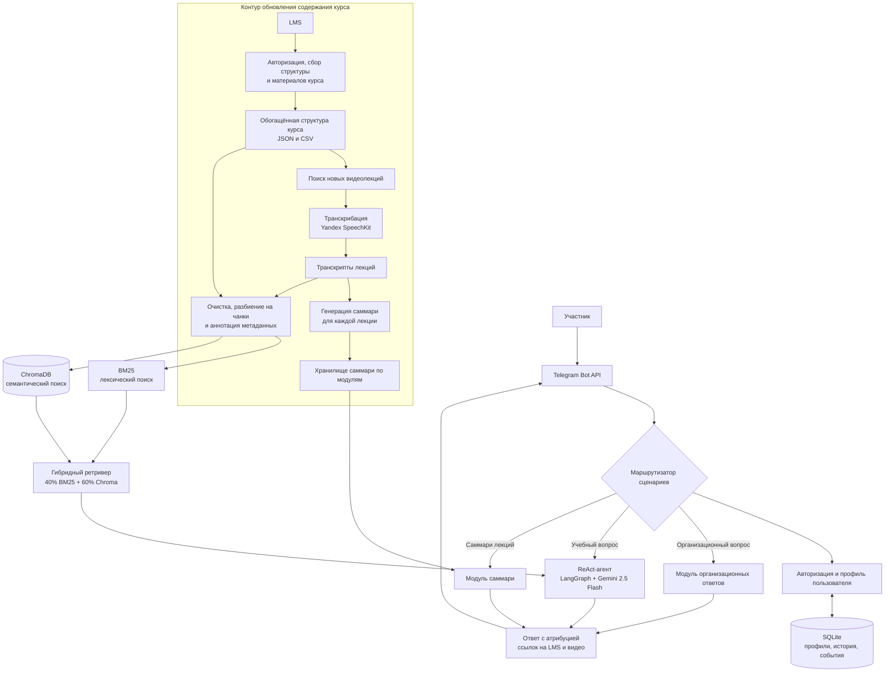

# Digital Shift: учебный и организационный ассистент

**Период исходной разработки:** октябрь — ноябрь 2025.  
**Роль:** соавтор архитектуры и ведущий инженер.

## Задача

Дать участникам образовательной программы единый интерфейс для учебных и организационных вопросов, поиска по материалам курса и подготовки кратких конспектов.

## Логика решения

## Что демонстрирует кейс

- разделение учебных и организационных сценариев.
- ReAct-агента для учебных вопросов и отдельный контур организационных ответов.
- гибридный поиск по материалам. BM25 даёт 40% веса, ChromaDB — 60%.
- аннотацию фрагментов материалов метаданными и проверку ссылок на LMS и записи лекций.
- автоматический конвейер обновления курса. Он получает структуру и материалы из LMS, выявляет новые видеолекции, транскрибирует их, обновляет базу знаний для RAG и сохраняет метаданные источников.
- отдельный контур саммаризации каждой лекции. После загрузки лекции в LMS участник может получить её структурированное саммари через бота. Для первого модуля подготовлено 22 саммари.
- обновление структуры курса через интеграцию с LMS и пересборку индексов BM25 и ChromaDB.

## Результат первого потока

За период с 23 октября по 24 декабря 2025 года в журнале зафиксировано 1 558 событий от 71 уникального ID. Пользователи отправили 517 сообщений. 55 ID проявили активность в 2 и более календарных днях. 51 ID совершил 5 и более событий.

