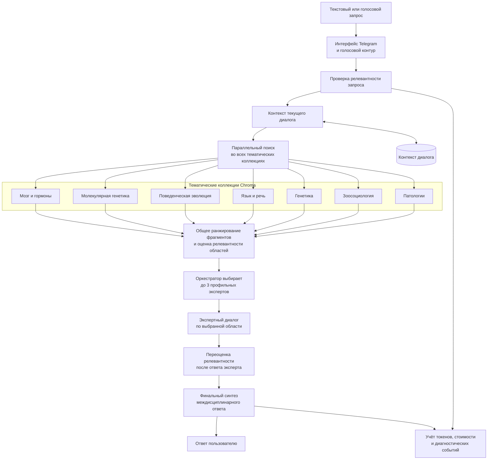

# Многоступенчатый RAG-ассистент

**Период исходной разработки:** октябрь — ноябрь 2024.  
**Роль:** соавтор архитектуры и ведущий инженер.

## Задача

Организовать поиск по тематическим базам знаний с сохранением контекста диалога и поддержать текстовый и голосовой формат взаимодействия.

## Логика решения

## Что демонстрирует кейс

- многоступенчатый RAG с 7 тематическими векторными коллекциями. Каждая коллекция соответствует отдельной научной области и загружается из собственного набора источников.
- асинхронный параллельный поиск по всем коллекциям с общим ранжированием найденных фрагментов.
- отбор до 3 профильных экспертов по среднему баллу релевантности области. Для каждого выбранного эксперта формируется отдельный вопрос и ответ на основе его фрагментов базы знаний.
- переоценку ответа эксперта через повторный поиск. Это позволяет подключать следующий профиль только когда он добавляет содержательный ракурс к исходному вопросу.
- финальный синтез ответов экспертов в одном междисциплинарном ответе с сохранением контекста диалога.
- текстовый и голосовой интерфейсы, а также интерактивное отображение стадий анализа для пользователя.
- отдельный учёт входных, выходных, кэшированных и визуальных токенов с расчётом стоимости использования моделей.
- ограничение нагрузки через очередь, пользовательские лимиты и кэш ответов.

## Результат образовательного эксперимента

Архитектура использовалась в эксперименте с ИИ-профессором на курсе «Биология поведения человека». По данным исследования Школы управления СКОЛКОВО и ТюмГУ, результат студентов оказался на 60% ближе к эталонным знаниям по сравнению с традиционным форматом обучения.

[Описание исследования «ИИ вместо профессора: прорыв в образовании»](https://www.skolkovo.ru/researches/ii-vmesto-professora-proryv-v-obrazovanii/)

