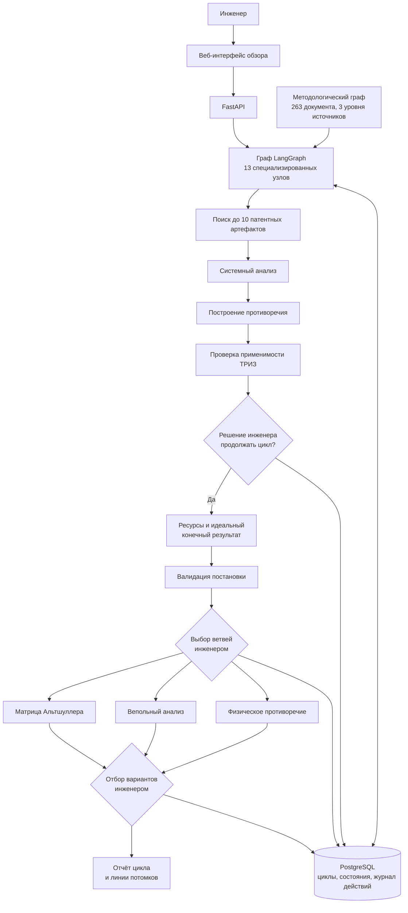
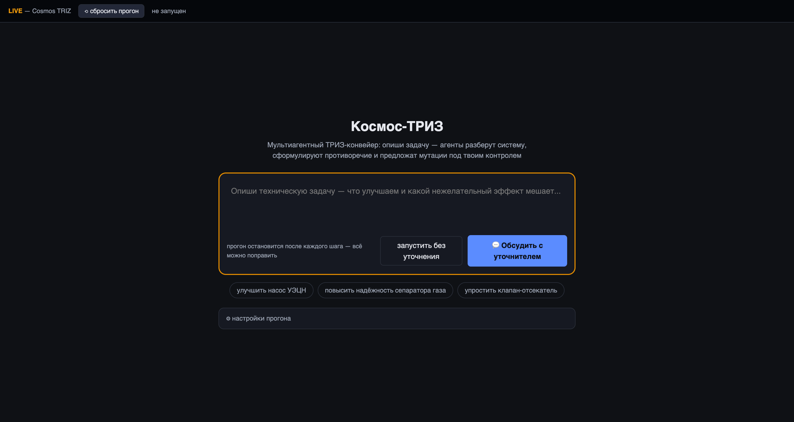
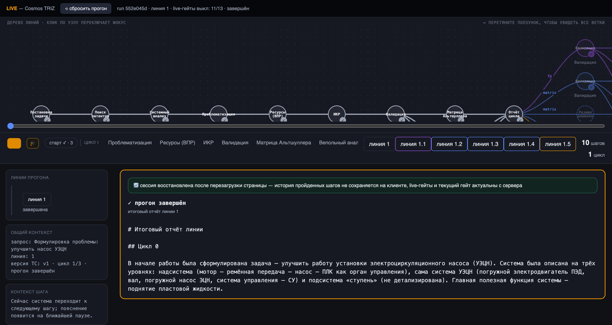

# Мультиагентная система для инженерных задач по ТРИЗ

**Период исходной разработки:** июнь — август 2026.  
**Роль:** соавтор архитектуры и ведущий инженер.

## Задача

Помочь инженеру пройти изобретательский процесс по ТРИЗ от нечёткого описания проблемы до нескольких проверяемых вариантов улучшенной технической системы. Система не заменяет методолога. Она делает ход рассуждения, основания выводов и решения человека прозрачными.

## Логика решения

## Интерфейс и контроль пользователя

Стартовый экран принимает инженерную задачу обычным языком. Пользователь может начать анализ сразу или сначала обсудить формулировку с уточняющим агентом.

Рабочее пространство показывает весь путь задачи, текущую линию и параллельные ветви решения. На каждом значимом переходе пользователь может проверить результат и выбрать дальнейший ход.

## Архитектурные решения

- Граф включает 13 специализированных узлов. Среди них поиск до 10 патентных артефактов, системный анализ, постановка противоречия, работа с ресурсами, формулирование идеального конечного результата и три пути генерации решений.
- После проверки задачи пользователь решает, продолжать ли полный цикл ТРИЗ. Агент не может автоматически отказать в работе на основании собственного вердикта.
- Матрица Альтшуллера, вепольный анализ и физическое противоречие запускаются параллельно. Пользователь оставляет одну или несколько ветвей, а система создаёт для них отдельные линии продолжения.
- Решение развёрнуто внутри контура организации на LangGraph, FastAPI и PostgreSQL. Внешняя управляющая плоскость не используется.
- Методологический контур работает с корпусом из 263 документов. Граф памяти разделяет 3 уровня источников и показывает происхождение каждого тезиса в вердикте.
- Каждое действие на гейте фиксируется в журнале. Архитектура допускает замену временной идентификации пользователя на корпоративный SSO без переработки журнала.

## Результат пилота

Пилот привёл к заключению 1 коммерческого договора. Название заказчика, условия договора, клиентские материалы и детали реализации не раскрываются.

