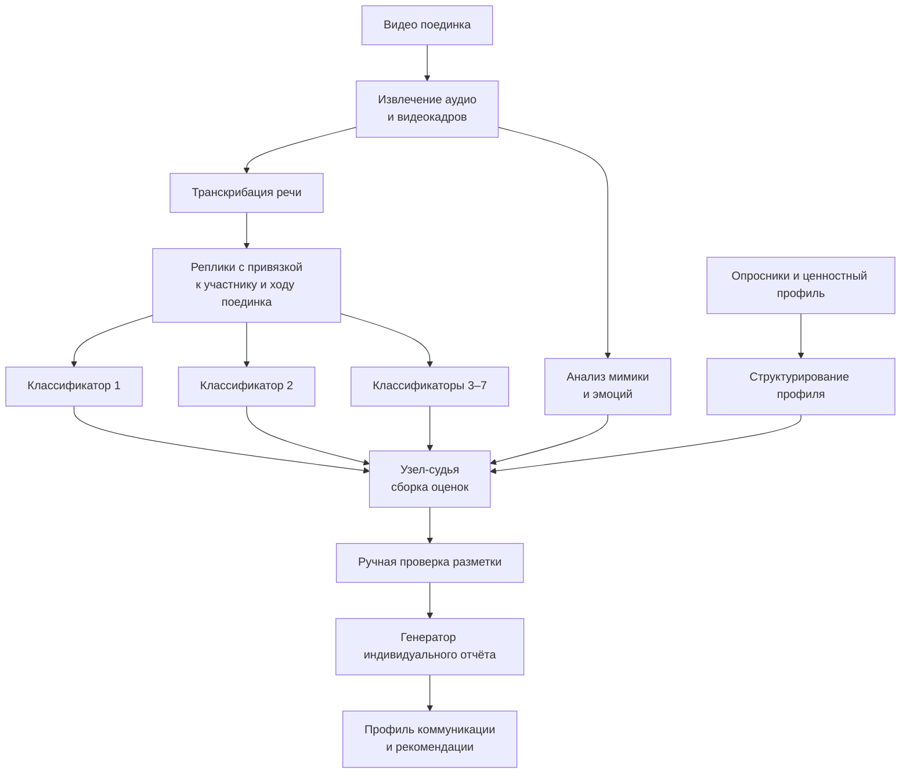

# Мультимодальный анализ переговорных поединков

**Период исходной разработки:** сентябрь — октябрь 2025.  
**Роль:** соавтор архитектуры и ведущий инженер.

## Задача

Собрать индивидуальный отчёт по переговорному поединку, объединяя анализ речи, мимики и результаты опросников.

## Логика решения

## Что демонстрирует кейс

- мультимодальный конвейер: видео, аудио, текст и опросники.
- раздельную подготовку сигналов и их сборку в отчёт.
- автоматизацию формирования индивидуального результата.

## Апробация

Среда апробирована в 3 когортах. В исследовательской выборке участвовали 123 человека. Зафиксировано 244 выступления и 1 378 реплик. Полные ценностные профили собраны для 107 участников. Первичная разметка строилась через 7 параллельных узлов-классификаторов и отдельный узел-судью.

В обратной связи участники регулярно отмечали формат управленческих поединков как наиболее полезную и запоминающуюся часть программы. Замечания о сложности кейса и детализации разбора были использованы при его доработке.

