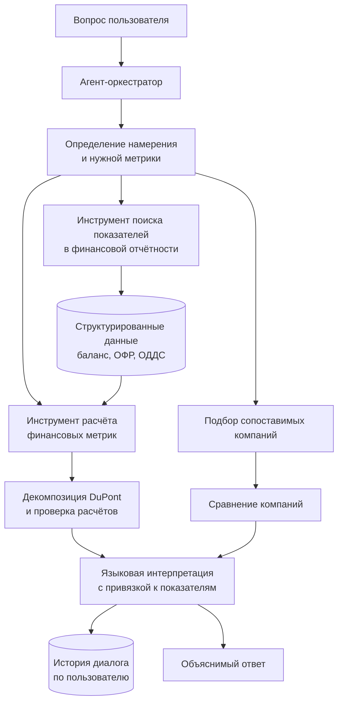

# Агент финансового анализа

**Период исходной разработки:** январь — апрель 2025.  
**Роль:** соавтор архитектуры и ведущий инженер.

## Задача

Помочь пользователю получить объяснимый анализ финансовых показателей: от запроса и поиска данных до расчёта и сравнения компаний.

## Логика решения

## Что демонстрирует кейс

- разделение вычислений и языковой интерпретации.
- два независимых инструмента. Один ищет показатели в отчётности, второй рассчитывает финансовые метрики.
- сравнение компаний как отдельный шаг сценария.
- развитие продукта по обратной связи заказчика.
- работу с балансом, отчётом о финансовых результатах и отчётом о движении денежных средств.

## Учебный контур

В учебном наборе представлены данные 5 компаний розничного сектора. Ассистент рассчитывает 8 типов показателей, включая ROE, рентабельность продаж, оборачиваемость активов, финансовый рычаг и валовую рентабельность. Контекст диалога хранится отдельно для каждого пользователя.

## Внедрение

Решение внедрено на потоке финансового курса программы MBA. Численность потока и материалы обучения не раскрываются.

