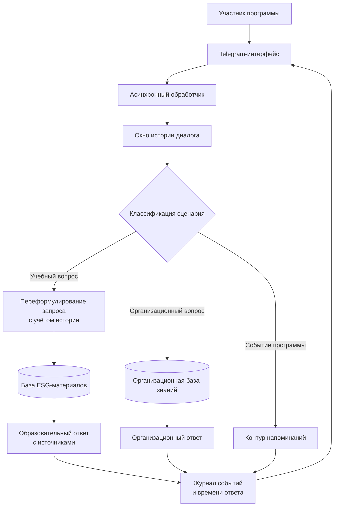

# Ассистент ESG-программы

**Период исходной разработки:** апрель — май 2025.  
**Роль:** соавтор архитектуры и ведущий инженер.

## Задача

Поддержать участников ESG-программы в учебных и организационных вопросах, сохраняя необходимый контекст диалога и напоминая о важных действиях.

## Логика решения

## Что демонстрирует кейс

- разделение учебного и организационного режимов.
- две базы знаний. Одна для ESG-материалов и одна для организационных вопросов.
- history-aware поиск, который использует контекст диалога для уточнения запроса.
- асинхронную обработку запросов.
- сценарные проверки параллельных запросов.

