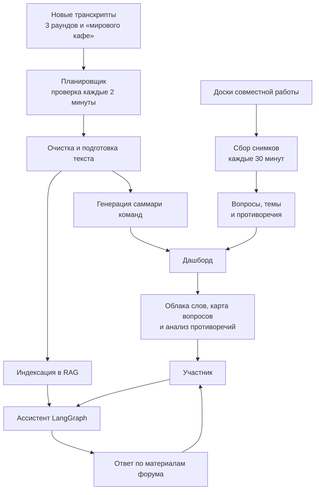

# Ассистент и дашборд для форума

**Период исходной разработки:** июль 2025.  
**Роль:** соавтор архитектуры и ведущий инженер.

## Задача

Автоматизировать работу с материалами форума: обновлять базу знаний по новым транскриптам, готовить конспекты и показывать участникам карту тем, вопросов и противоречий.

## Логика решения

## Что демонстрирует кейс

- автоматическое обновление базы знаний.
- ассистента на LangGraph.
- объединение транскриптов, конспектов и данных совместной работы.
- наблюдаемость статуса обновления и визуальный дашборд.
- проверку новых транскриптов каждые 2 минуты и получение снимков доски совместной работы каждые 30 минут.

## Объём обработанных материалов

Система собрала и подготовила 28 файлов транскриптов из 3 раундов обсуждений и формата «мировое кафе». Для 8 команд созданы саммари. Дашборд содержит 9 наборов данных для облаков слов, 2 набора результатов анализа противоречий, 15 выгрузок вопросов и 41 снимок досок совместной работы.

