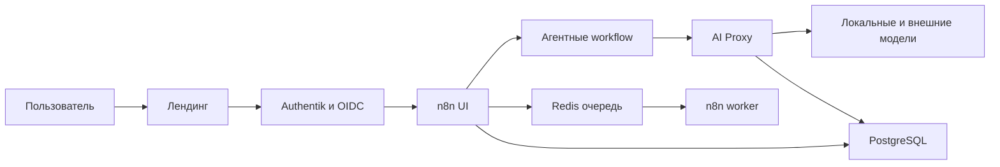

# Low-code мультиагентная лаборатория на n8n

**Статус проекта:** бета-тестирование.  
**Период исходной разработки:** май — сентябрь 2026.  
**Роль:** соавтор архитектуры и ведущий инженер.

## Задача

Развернуть лабораторную среду для обучения созданию low-code агентных и мультиагентных систем. Среда даёт пользователям контролируемый доступ к n8n и ИИ-сервисам, а команде позволяет сопровождать работу платформы, управлять доступом к моделям и видеть использование.

## Архитектурный контур

## Что показывает кейс

- разделение пользовательского входа, доступа, workflow и наблюдаемости.
- подход к обучению созданию low-code мультиагентных систем.
- связь между использованием моделей, расходом токенов и анализом результатов.
- границы ответственности платформы и пользователя.

## Архитектурные решения

- Платформа развёртывается в 3 независимых контурах. Веб-контур содержит лендинг, Authentik, Caddy и n8n UI. Контур выполнения содержит AI Proxy и n8n worker. Контур данных содержит PostgreSQL и Redis.
- Выполнение задач вынесено в Redis-очередь и отдельный worker. Это сохраняет отзывчивость интерфейса при долгих агентных сценариях.
- Authentik выступает единым OIDC-провайдером для лендинга и сервисов лаборатории. Группы пользователей определяют роль и квоту токенов.
- Один скрипт провизионинга создаёт учётные записи сразу в Authentik, n8n и AI Proxy. Он также создаёт личный проект пользователя в n8n, выдаёт ключ доступа к моделям и задаёт начальный баланс токенов.
- AI Proxy изолирует доступ к моделям. Он принимает OpenAI-совместимые запросы, проверяет ключ и баланс пользователя, передаёт запрос поставщику модели и фиксирует использование в PostgreSQL.
- Общая папка артефактов подключается к n8n UI и worker в режиме только для чтения. Поэтому ручные и фоновые сценарии работают с одинаковыми материалами пользователя.

## Статус проверки

Локально развернутая среда находится в бета-тестировании. Количественные результаты будут добавлены после завершения теста.

