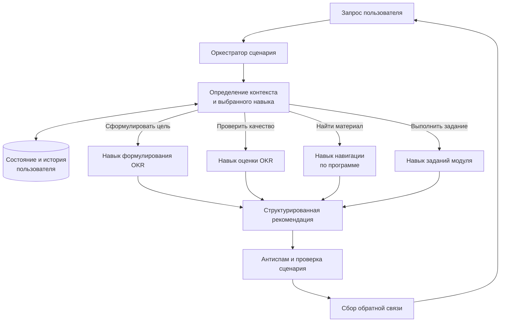

# Ассистент по OKR

**Период исходной разработки:** август 2024.  
**Роль:** соавтор архитектуры и ведущий инженер.

## Задача

Помочь пользователю сформулировать и оценить цели и ключевые результаты, а также сориентироваться в материалах образовательного сценария.

## Логика решения

## Что демонстрирует кейс

- модульное разделение навыков внутри агентного сценария.
- отдельные контуры для формулирования OKR, оценки качества, навигации по материалам и прохождения заданий модулей.
- оркестрацию выбора нужного навыка по пользовательскому запросу.
- уточняющий шаг перед поиском по материалам и хранение контекста пользователя внутри выбранного навыка.
- отдельный контур защиты от спама и модуль сбора обратной связи.

## Внедрение

Ассистент запущен на 3 потоках программы OKR Школы управления СКОЛКОВО. Учебные материалы и пользовательские данные не раскрываются.

