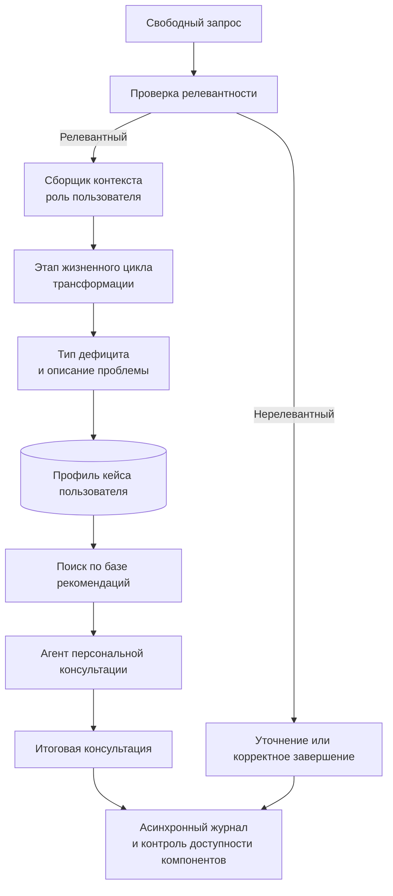

# Консультант по трансформационным проектам

**Период исходной разработки:** август — ноябрь 2025.  
**Роль:** соавтор архитектуры и ведущий инженер.

## Задача

Структурировать свободный запрос по трансформационному проекту и подобрать рекомендации, соответствующие контексту пользователя.

## Логика решения

## Что демонстрирует кейс

- управляемую консультацию из свободного текстового входа.
- отдельный компонент проверки релевантности запроса.
- последовательное уточнение роли, этапа и проблемы через сборщик контекста пользователя.
- отдельный компонент поиска по базе знаний и агент, формирующий персонализированную консультацию.
- асинхронную обработку запросов, журналирование и проверки доступности ключевых компонентов.
- классификацию дефицитов по 4 этапам жизненного цикла трансформационного проекта и 4 тематическим группам дефицитов.

## Результаты пилота

Бота запустили 145 человек. 118 пользователей ограничились нажатием кнопки старта. 20 остановились на формулировке кейса или задали нерелевантный запрос. 7 пользователей получили итоговую консультацию. Всего зафиксировано 239 взаимодействий, из них 113 содержательных, без учёта простого нажатия кнопки старта.

Результат пилота выявил ключевую точку улучшения: сценарий первого шага и помощь при формулировке кейса требуют доработки. Отзывы через форму обратной связи не поступили.

