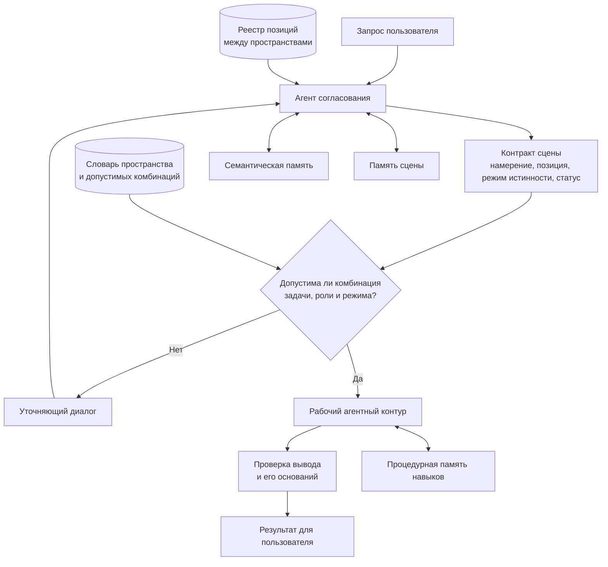

# Socrates Harness для согласования задачи и сохранения оснований вывода

**Статус проекта:** бета-тестирование.  
**Период исходной разработки:** август — ноябрь 2026.  
**Роль:** соавтор архитектуры и ведущий инженер.

## Задача

Socrates — агентный harness для задач, где важно не потерять основания вывода. До запуска рабочего контура он согласует с пользователем задачу, его позицию, режим истинности и цель. Это предотвращает преждевременный переход от неполного контекста к совету, решению или действию.

## Основная идея

Перед следующим шагом система фиксирует:

- намерение пользователя.
- позицию, с которой пользователь рассуждает.
- режим истинности утверждения.
- достаточность данных для перехода.
- факты, предположения, интерпретации и открытые вопросы.

## Двухконтурная логика

## Польза

- делает основания решения наблюдаемыми.
- отделяет известное от допущений.
- добавляет управляемую паузу перед значимым действием.
- помогает пользователю сохранять контроль над направлением рассуждения.

## Архитектурные решения

- Контракт сцены содержит 4 поля: намерение пользователя, позицию, режим истинности и статус согласования.
- Формулировка пользователя и техническая привязка к словарю существуют отдельно. Пользователь подтверждает свои слова, а система использует отдельную запись словаря для проверки допустимой комбинации.
- Словарь пространства описывает допустимые тройки «задача, роль, режим истинности». Он не позволяет подменить согласование формальным заполнением полей.
- В системе разделены 3 вида памяти: семантическая память пространства, память сцены и процедурная память навыков. Реестр позиций пользователя хранится отдельно и работает между пространствами.
- Агент ведёт диалог и вызывает один инструмент согласования. Код проверяет только данные и не пытается заменить агент правилами на основе ключевых слов.

## Результаты бета-тестирования

На итоговом тесте согласования 8 пользовательских сценариев запускались по 2 раза. Контракт был подтверждён в 16 из 16 прогонов. Средняя длина диалога составила 3,7 реплики. Повторных запросов цели не было.

В отдельном тесте фильтра позиций система предложила добавить 34 из 36 подходящих ролей и не предложила ни одной из 26 заведомо нерелевантных ролей.

## Статус проверки

Решение находится в бета-тестировании. Указанные выше метрики относятся к инженерным сценариям проверки. Продуктовые результаты будут добавлены после завершения теста.

